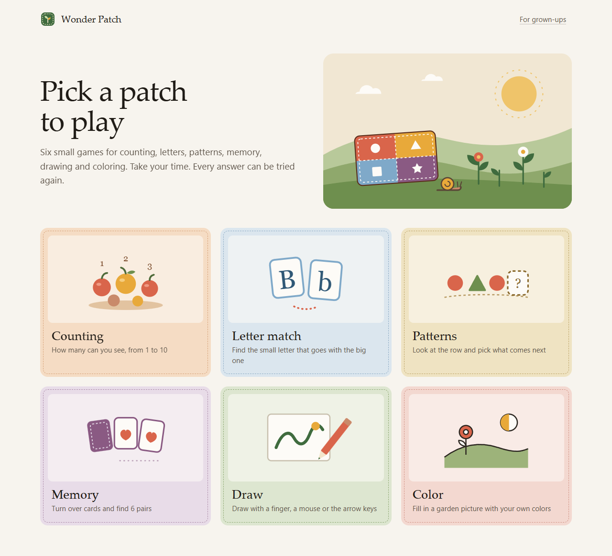

# Wonder Patch

Six small learning and art activities. No account, no subscription, no app store.



Pick a patch and take your time:

| Activity | What you do |
| --- | --- |
| Counting | Count flowers from 1 to 10 and choose a number. |
| Letter match | Match an uppercase English letter to its lowercase partner. |
| Patterns | Find the next shape in a repeating pattern. |
| Memory | Turn over twelve cards to find six pairs. |
| Draw | Draw with a mouse, touch, or keyboard. Undo, clear and save an SVG. |
| Color | Paint an original garden picture. Every region also has a labelled button. |

The first three games have five-question rounds. Wrong answers can be tried again. There are no timers, rankings, ads or streaks. A grown-up may need to read the instructions with a child. These are practice activities, not a tested curriculum or assessment.

## Try it

Download the project, extract the folder, and open **index.html** in a current browser. Keep the `src`, `assets` and stylesheet files alongside it. The downloaded app can play without an internet connection.

For a local web address, install free [Node.js](https://nodejs.org/) 22 or newer and run:

```sh
npm start
```

Open `http://127.0.0.1:4381`. The local server uses only Node's built-in modules; package installation is not required to play. It binds to this computer, rather than exposing a service to the network.

## Art and progress

Art lives in the open activity. Leaving it or reloading discards the picture. **Save picture** downloads an SVG file to your device; it does not upload it anywhere. Drawing supports arrow-key movement and Space to lift or lower the pen. Coloring has a list of named regions so it does not require precise pointing.

Finished-round counts last for the current visit by default. In **For grown-ups**, **Save progress on this device** optionally keeps only six completion counters in this browser. There are no profiles, names, ages or contact details. Turning saving off removes saved counts. **Reset counts** clears them and turns saving off. Storage being blocked or full does not prevent play.

The app has no analytics, ads, accounts, microphone/camera access, remote fonts or runtime API calls. If it is hosted on a website, the browser must still request its static files and that host may keep its own access logs. Downloading and opening the folder avoids a hosting service entirely.

## Develop and check

All runtime code is plain HTML, CSS and JavaScript. There are no runtime packages and no bundler. The only development dependency is Playwright for browser checks.

```sh
npm ci --ignore-scripts
npm test
npm run check
npm run build
npx playwright install chromium
npm run test:browser
```

`npm run build` copies the thirteen local runtime files into `dist/`, suitable for a static host or another local folder. Paths are relative, including under a subdirectory. It does not publish anything.

The Node tests exercise generated questions, retries, completion counting, memory interactions, drawing coordinates, opt-in storage and the static server's file allowlist. Browser tests exercise all six activities, keyboard and touch input, art downloads, storage failures, subdirectory hosting and downloaded-file offline play. Results are written outside the source directory. Set `PW_OUTPUT_DIR` to choose a test-results folder, or `PW_EXECUTABLE_PATH` to use an already installed Chromium-based browser.

## Scope and limitations

- English letter-case matching only. There is no audio, phonics lesson or speech recognition.
- Counts are per browser, not per child; there is no sync or classroom reporting.
- Art is not automatically saved. SVG downloads are local files you manage.
- The drawing tool is intentionally small. It has no layers, image import, pressure support, collaborative drawing or promised stylus palm rejection.
- This is a browser app, not a released Android/iOS package. Mobile browser behavior and local file opening can vary; use a static web host where direct file opening is restricted.
- Automated checks and desktop browser review do not replace testing with families, educators, screen-reader users or physical touch/stylus devices.

## Design and provenance

The code and procedural SVG artwork were written for this project. No photos, fonts, audio or third-party application code are bundled. [Design research](RESEARCH.md) records the interaction lessons from existing educational and drawing projects, including their issue discussions. It does not claim this small app replaces them.

This is an AI-assisted project led by Jgolding1998: Claude Code led the interface and original illustrations; Codex implemented the game state, storage, test harness and verification. See [AGENTS.md](AGENTS.md) for the boundaries contributors should preserve.

MIT licensed. The test-only Playwright packages use Apache-2.0; they are not included in the static app build.
